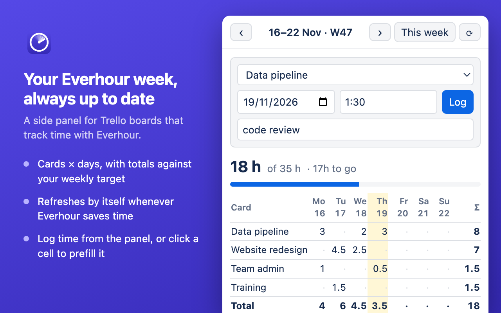
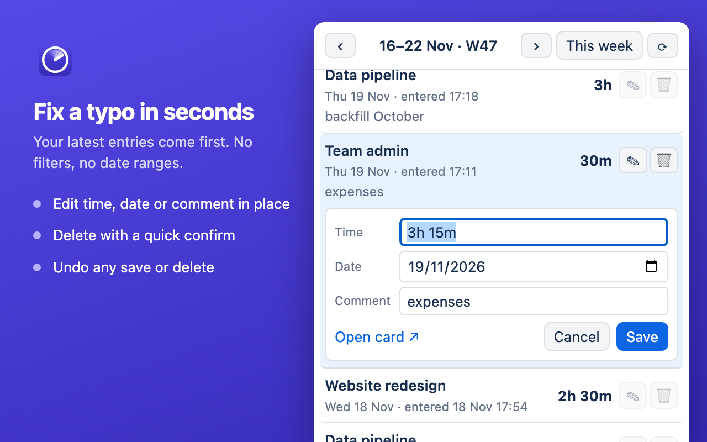

# Quick Time Log & Edit for Everhour on Trello

A Chrome side panel for Trello boards that track time with the [Everhour](https://everhour.com) Power-Up. It shows your week at a glance and your latest entries. You can log, edit or delete time without going through Everhour's reports and filters.

Not affiliated with or endorsed by Everhour, Trello or Atlassian.

## What it does

- **Your week.** A grid of cards × Mon–Sun, with day and card totals measured against a weekly target. The target defaults to 35 h and you can change it at the bottom of the panel. Today is highlighted. ‹ and › move between weeks, and the panel remembers which week you were on.
- **Always current.** When you add or change time in Everhour's own dialogs, the panel refreshes by itself.
- **Log time.** Pick a card (recently used cards come first), a date, a duration and an optional comment, then press Enter. Durations can be written as `1.5`, `1:30`, `90m` or `1h 30m`. Clicking a cell in the week grid fills in that card and day for you.
- **Latest entries.** Your entries on this board, newest first, so a typo you just made is at the top. Click an entry to change its time, date or comment. 🗑 deletes it after a confirm. After every log, save or delete, a bar at the bottom of the panel offers **Undo**, then **Redo**. ⌘Z and ⇧⌘Z (Ctrl+Z and Ctrl+Y on Windows) step back and forward through everything you did in the panel, as long as you aren't typing in a field. If an entry was changed in Everhour's own dialogs in the meantime, undo leaves it alone and says so.

## Install

1. Open the Chrome Web Store link (unlisted, shared within the team) and click **Add to Chrome**.
2. Pin the clock icon from Chrome's puzzle-piece menu.
3. Open a Trello board that uses the Everhour Power-Up and click the clock icon. The panel opens beside the board.

If the panel says Everhour isn't loaded, or that the tab is running an older version, reload the Trello tab once. You need to do this after installing or updating the extension.

## How it works

Everhour's Power-Up runs inside Trello in frames served from app.everhour.com. The extension adds a small script to those frames. The script uses the connection Trello already gives Everhour to read your time on the current board.

Changes are the same requests that Everhour's own Add time and Edit dialogs send. They are made only when you click Log, Save, Delete or Undo. After a change, the card's Everhour time badge is updated the same way Everhour updates it.

There is no API key, no extra sign-in and no server of our own. Data goes only to Everhour, and to Trello through the Power-Up library. See [PRIVACY.md](PRIVACY.md).

## Limitations

- It works only on boards that use the Everhour Power-Up, and only on your own entries.
- It relies on how Everhour's Power-Up works inside Trello, which is not a public API. An Everhour update could break it. If that happens, Everhour's own dialogs keep working as before.
- If Everhour refuses a change, the panel shows Everhour's error and nothing is changed.

## Development

- To run from source, open `chrome://extensions`, turn on Developer mode, click **Load unpacked** and pick this folder. After changing anything under `src/content/`, click ↻ on the extension and reload the Trello tab.
- `npm test` runs the unit tests. It needs Node 18 or later; there are no dependencies.
- `python3 dev/serve.py` serves the panel on mock data at <http://localhost:8765/src/sidepanel/index.html>.
- `sh dev/store-assets.sh` regenerates the store images in `store/`.
- `npm run package` builds `dist/quick-time-log-<version>.zip` for the Chrome Web Store. [docs/store-listing.md](docs/store-listing.md) has the text for every dashboard field.

Design notes are in [CLAUDE.md](CLAUDE.md), [docs/everhour-api.md](docs/everhour-api.md) and the [devlog](docs/devlog.md).
